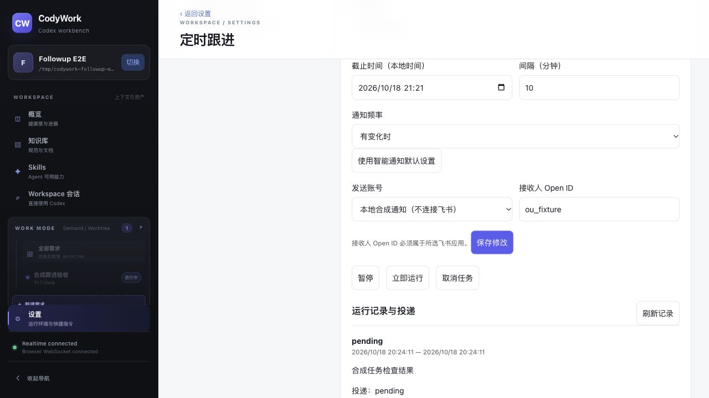

# 内置定时跟进 Skill 验收

- 基线：`3397bfa` 加本地未提交修改；Core v0.43.1 未修改。
- 环境：独立临时 SQLite、合成 Workspace/需求 worktree；`http://127.0.0.1:43327`。
- 使用 native RPC fixture；旧 Thread 的 resume 不安装 dynamic tools。fixture 实际执行发布的 Node helper，通过私有 Unix socket 调用生产跟进服务；不是实际模型推理。
- 未启动外部 provider，没有真实飞书发送。未访问或修改生产环境。
- `pnpm verify` 成功：228 服务端、116 前端测试，类型检查及构建通过。Skill validator 通过；已有 Vite 大包警告不影响构建。

## 观察结果

| 用例 | 本轮结果与边界 |
| --- | --- |
| E2E001 | 会话认证恢复及刷新通过；登录错误密码分支本轮未重跑 |
| E2E004 | 既有需求深链、来源会话切换及刷新恢复通过；完整需求管理不在本轮范围 |
| E2E007 | 慢回复前先显示一条用户消息及“正在发送”，之后正常收敛 |
| E2E008 | 四轮消息有序，双标签同一轮各一条，刷新不重复；内部桥接文本未混入最终用户输入 |
| E2E011 | 双标签同步通过；主动停止服务时请求失败和连接中状态可见，启动并刷新后恢复原历史，无重发；未证明无需刷新时的全自动恢复 |
| E2E016 | 桌面 1280 下文档宽度等于视口；正常操作 console 无 error/warn。主动停机期间产生预期 Failed to fetch，刷新恢复；窄屏、完整键盘流程本轮未测 |
| E2E017/018 | 内置 Skill 在列表可见，详情可读，显式指定后可调用；其余完整 Skill/快捷指令流程未重跑 |
| E2E019 | 自动测试覆盖 inactive 阶段拒绝、socket 权限、结束失效、可信来源绑定；真实模型/沙箱边界 BLOCKED，未作为通过 |
| E2E025 | 旧会话 Skill 返回真实 ID，后台显示相同来源、10 分钟、change、截止时间与独立 fork；立即运行得到 pending 和运行记录，投递仅 pending，取消两步确认成功。最终构建再次显式调用创建成功 |
| E2E020 | BLOCKED：未授权真实外部发送，provider 禁用 |

本轮是针对旧会话工具缺失的增量验收，不把上述部分覆盖计为完整 E2E 用例通过。真实模型是否正确选择/执行 Skill 尚未实测，不沿用 fixture 成功替代真实模型证据。

## 缺陷与修复

- 旧 resume 无法补装工具：增加随产品发布的 Skill，明确 JSON 参数；通过本轮局部桥接使用同一后端服务。
- 模拟器此前错误接受 resume dynamicTools：改为忽略新增工具，并增加真实 helper 的旧会话测试。
- 桥接说明污染用户消息：改为写入临时 Skill 文件，不修改原始用户文字。
- 排队消耗桥接有效期：本轮 started 后才激活并计时；完成/失败和服务关闭清理。两小时为实际执行起算上限。
- 独立只读复核确认排队问题已修复；来源绑定和当前同步写入路径无新增阻塞发现。

## 清理

关闭临时标签，隔离服务收到退出信号后已关闭监听，但进程未及时退出，最终对核实后的唯一 fixture PID 强制终止；未将此算作优雅退出通过。临时数据目录移回废纸篓，可恢复。无提交、推送或部署；没有真实飞书消息。
