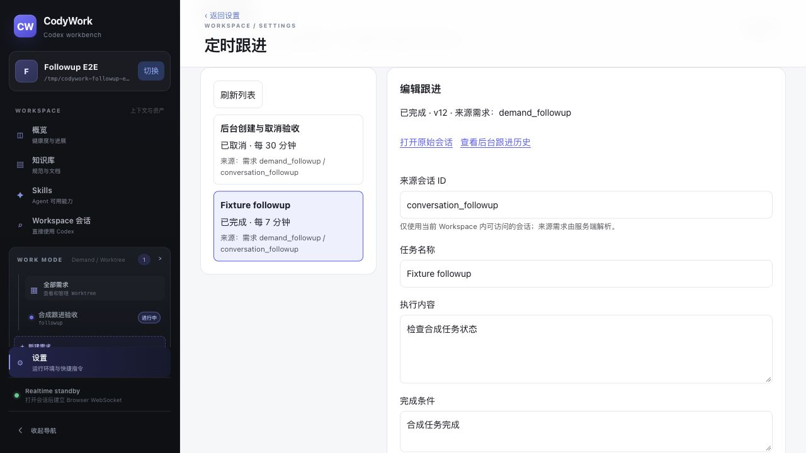

# 定时跟进集成验收 — 2026-10-18

## 环境与结论

- 基线：CodyWork `bb56c89` 加本地未提交修改；CodyWebCore v0.43.1，无 Core 修改。
- 隔离环境：http://127.0.0.1:43327；独立临时 SQLite、合成 workspace、Git 仓库和需求 worktree。
- 使用原生协议测试 fixture，不是实际模型；禁用所有外部 provider，未向飞书发送消息。
- 最终 `pnpm verify` 成功：服务端 225、前端 116 测试通过，类型检查和构建成功。已有 Vite 大包警告仍存在。
- 核心本地闭环通过；不代表真实飞书、真实模型和全部关联 E2E 已验收。

## 浏览器覆盖

| 用例 | 结果 | 观察 |
| --- | --- | --- |
| E2E001 | 本地通过 | 错误密码、登录、刷新与多标签认证 |
| E2E004 | 本地通过 | 需求深链、切换会话、刷新历史、后退与前进 |
| E2E007 | fixture 通过 | 慢响应前用户消息先展示，回复后及刷新无重复 |
| E2E008 | fixture 通过 | 四轮对话顺序；工具创建跟进和快捷指令；来源历史未混入后台检查 |
| E2E011 | fixture 通过 | 双标签同步；服务器停止后重连提示；持久化重启恢复，无消息重复 |
| E2E016 | 部分通过 | 桌面导航、工具箱和无横向溢出通过；视口覆盖未生效，窄屏受阻，完整键盘流程未测 |
| E2E017 | 部分覆盖，完整用例未运行 | AI 创建快捷指令并在工具箱可见；未验收完整多 Skill、排队及 CRUD 流程 |
| E2E019 | 实际运行时受阻 | 自动测试验证 fork 请求、只读模式和后台人工命令拒绝；未验证真实模型的文件/网络权限执行 |
| E2E020 | 受阻 | 没有真实飞书发送授权；仅验证持久化 outbox 入队 |
| E2E024 | 完整用例未运行 | 自动回归覆盖后台跟进不触发重复智能通知；未执行真实长任务与发送 |
| E2E025 | 核心本地闭环通过 | AI 工具创建、页面创建、修改与刷新、暂停恢复、立即运行、两步取消、独立 fork、通知单独重试、重启保留 |

E2E025 中首次通知故意使用无效合成密文，确认失败路径；换为正确加密的假凭据后，只重试通知，运行记录仍为同一次，投递显示 `pending`，没有伪装成已发送。另一任务检查得到 pending 后被取消，重启仍保持取消。没有等待真实十分钟间隔或实际截止；时钟、租约、截止和并发行为由自动测试覆盖。

## 修复与审查

- 修复 fork 等待中取消后仍提交，以及准备阶段超时后迟到提交的竞态。
- 修复暂停过程中通知失败/租约过期导致无法恢复的状态。
- 运行异常持久化为可见错误；投递展示实际 outbox 状态，重试不重跑检查。
- 修复 macOS Bash 3 空数组导致校验脚本失败的问题。
- 独立代码审查复核上述路径后未发现新的 P1 问题。

## 证据与清理

前端阶段记录见 `2026-10-18-followups-frontend.md`；本记录为最终集成结果，取代该阶段的计数及浏览器未运行结论。

临时浏览器标签已关闭；隔离服务已停止，临时目录移至系统废纸篓，可恢复。未提交、推送、合并或部署，未修改真实业务仓库和飞书数据。
