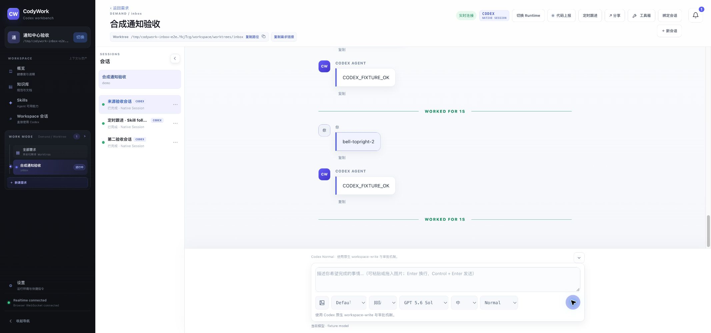

# 通知入口移到全局右上角

- 仅调整通知入口与样式：左侧入口移除，单个全局铃铛固定右上角，页面标题栏预留空间；现有通知数据与投递逻辑不变。
- UI/UX skill：保留44px图标按钮、可访问名称、hover/focus反馈；未读角标99+封顶，Escape关闭抽屉后恢复焦点。
- 本轮开始前已有 Flux 等其他未提交改动，均保留；自动化基于当前完整工作区执行，不将其他功能归为本轮实现。
- `pnpm verify`通过：服务端250项、前端129项，类型检查与构建通过；新增全局唯一入口及纯图标/角标/焦点回归。
- 使用隔离 SQLite、一次性 Workspace、协议 fixture和禁用外部 provider 的本地 production build；未修改生产数据、未发送真实飞书消息。
- E2E001：已登录浏览器恢复测试 Workspace 通过；本轮未重新测试错误密码。
- E2E004：需求和会话深链恢复，切页及刷新后的入口位置正常。
- E2E007：SLOW_E2E bell-topright-1 立即显示一份用户输入和正在发送状态，随后终态收敛。
- E2E008：新增三轮消息、回复顺序和去重正常。
- E2E011：第二标签恢复前两轮，第三轮实时同步到第一标签，两边均仅一份。
- E2E016：2133px桌面无横向溢出；操作区最右侧到铃铛相距20px，无遮挡；控制台error为空。请求820px覆盖后实际仍为2133px，窄屏 BLOCKED，已reset覆盖。
- E2E017/026：需求会话、设置、概览均显示同一个右上角入口；键盘Enter打开抽屉，标为未读显示角标1，Escape关闭并回到铃铛；概览刷新后角标1仍保留。
- E2E024/025/019：本轮未改后台通知生成、跟进执行及权限逻辑；不重复冒充外部投递或权限全链路通过。
- 截图：assets/2026-10-22-bell-topright.png。
- 清理：关闭两个测试标签、停止隔离服务、临时目录移回废纸篓。未提交、推送或部署。

