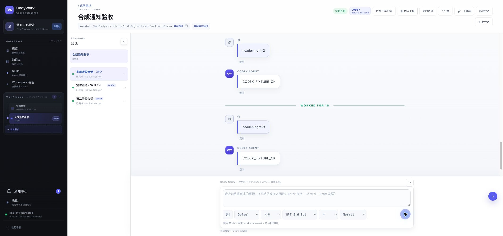

# 定时跟进入口右移验收

- 基线：`e823337`；本轮仅移动 App.vue 中按钮的 DOM 位置，保留 selectedConversation 条件与原跳转处理器。
- 使用 UI/UX skill 检查操作分组，沿用现有 topbar-actions 的样式与换行规则，没有新增权限、通知或任务逻辑。
- 自动化：`pnpm verify` 通过（服务端243项，前端121项，含新增按钮归组回归测试），类型检查、构建通过。首次测试使用未直接声明的 compiler-sfc 导入导致类型检查失败，移除不必要依赖后重跑全量通过。
- 环境：本地 production build、隔离数据库与一次性 Workspace；原生协议 fixture，外部 provider 禁用，无真实消息或生产数据写入。
- E2E001：访问登录页、登录并恢复 Workspace 通过。
- E2E004：需求/会话深链及刷新恢复通过，标题前不再有独立跟进按钮。
- E2E007：SLOW_E2E header-right-1 发送后即有单份用户消息与“正在发送”，终态回复正常。
- E2E008：三轮新增合成对话均为单份、终态收敛正常。
- E2E011：第二标签恢复前两轮并发送第三轮，第一标签实时收到一次，连接正常。
- E2E016：2133px 实际视口无横向溢出，按钮位于右侧操作组且只有一个，console error为空。请求820px viewport后浏览器仍返回2133px，因此窄屏验收 BLOCKED，不计通过；已reset override。
- E2E017/025受影响入口：键盘 Enter 打开定时跟进页，来源会话字段正确为 conversation_inbox；未创建新任务、未重跑后台业务。
- 截图：assets/2026-10-22-followup-header.png。
- 清理：关闭两个临时标签，停止隔离实例，临时目录移入废纸篓。未提交、推送或部署。

