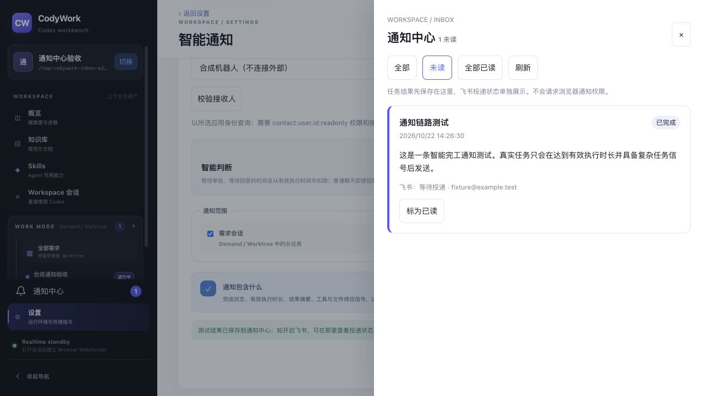

# 2026-10-22 站内通知与邮箱接收人验收

## 环境与边界

- 基线：`e5d0459`，本次未提交、推送或部署。
- 本地隔离 SQLite、一次性 Git baseline/worktree、原生协议 Codex fixture，监听 `127.0.0.1:43328`。
- 通讯录 resolver 为合成实现，仅允许 `@example.test`；飞书 provider 不启动。所有外部投递停留 pending，未发送真实消息。
- 使用真实浏览器操作生产构建；未把协议 fixture 当成真实模型或真实飞书验证。

## 结果

| 场景 | 结果与证据 |
| --- | --- |
| E2E001 登录 | 错误密码提示、正确登录、第二标签登录状态通过。 |
| E2E004 需求与会话恢复 | 需求深链、来源会话、通知回到原会话通过；未跳到后台 fork。 |
| E2E007 发送过程 | `SLOW_E2E inbox-round-1` 立即显示一份用户输入及发送状态，随后完成。 |
| E2E008 多轮 | 连续四轮输入及输出保持单份，第二标签第四轮计数为 1。 |
| E2E011 多标签/重启 | 第二标签实时接收后续消息；服务重启后恢复 connected，五轮历史及后台 fork 保留。 |
| E2E016 页面与键盘 | 1280px 无横向溢出，通知抽屉清晰；Escape 关闭并恢复铃铛焦点；移除最后未读项后焦点仍在 dialog。窄屏因本次浏览器未提供 viewport 调整能力，未验收，不记通过。 |
| E2E017 设置 | 本地通知无需机器人即可保存和创建测试通知；可选飞书邮箱配置正常。 |
| E2E019/020 通知集成 | 智能通知测试可落站内；飞书目标解析失败显示明确错误，成功保存后测试记录显示“等待投递”，不伪造成功。真实长任务计时未在浏览器等待30分钟，由自动化覆盖。 |
| E2E024/025 定时跟进与 Skill | 在来源会话显式调用 `$codywork-followup`，工具实际返回 task ID；配置为仅站内，后台运行完成并生成通知；原会话不混入检查过程。 |
| E2E026 通知中心 | 未读角标、全部/未读、已读/未读、全部已读、刷新及重载持久化通过；站内结果可单独发送到飞书队列。 |
| 历史失败补发 | 已完成历史任务修改通知邮箱后补发成功入队；SQLite 只读确认历史 run 数仍为1，旧 dead-letter receipt 已 superseded；没有重新查询或提交业务任务。 |

## 关键操作

1. AI 创建仅站内的跟进任务，手动将合成查询结果设为完成后立即运行；任务终态、后台历史、通知结果均可见。
2. 打开铃铛，将旧合成记录标已读，仅保留任务通知；改变已读状态、刷新页面后状态不丢失。
3. 输入 `hidden@example.test`，校验和保存均返回合成的通讯录不可见错误；改成 `fixture@example.test` 后显示“校验成功（未发送消息）”。
4. 补发站内已有结果，页面变为“等待投递”，发送按钮不再允许重复提交。
5. 服务重启后补发历史完成任务；终态任务参数仍不可编辑，但通知目标可独立修正。
6. 智能通知设置关闭飞书时测试只落站内，开启飞书时测试写入断开的合成 outbox。
7. 末轮页面控制台 error 日志为空。

## 自动化与审阅

- `pnpm verify`：服务端243项、前端120项，类型检查及构建通过；仅有既有 bundle size 警告。
- 覆盖按应用解析邮箱、权限错误、站内幂等、工作区隔离、收件人修正、旧 receipt 退役、崩溃恢复、异步写入取消、不可重复补发。
- 独立审阅检查了 outbox 并发、持久化意图和历史记录导入；发现的问题已修复，复核无剩余阻断项。
- 更新内置 Skill 的指导：默认站内，飞书可选，指定邮箱而非要求用户找 Open ID；通过 Skill 校验。
- UI 使用现有主题 tokens，并按 UI/UX skill 完成可访问抽屉和键盘焦点处理。

## 测试夹具说明与未覆盖项

旧 fixture 用2023年固定 turn 时间与当前实时终态混合，最初误生成一条长任务合成通知。已把 fixture 的 turn 时间改为当前一致时基；旧合成记录标已读，不以该记录证明真实长任务判断。

真实飞书通讯录可见范围、真实消息发送和最终 sent 回执需部署后在授权应用中验证。本轮未调用生产服务，也未修改生产数据。窄屏视觉检查待补。

