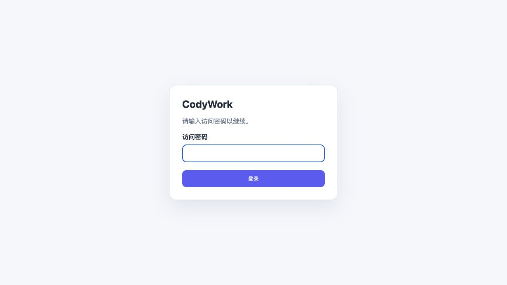

# CodyWork 并行开发快照部署

- 日期：2026-11-09
- 用户授权：将当前 CodyWork 改动部署到 `fdbd:dc01:ff:31d:5830:b5a4:4263:f20b`。
- 目标：该 IPv6 对应已有 `n37-222-012`；安装目录 `/data00/home/gouchao/code/github/CodyWork`，用户 gouchao，systemd 用户服务 `codywork.service`，端口 3001。
- 基线：`0e13ac4ebf12a551fe7616f48d5f95ee53ad317c`；Core 0.43.1。
- 部署内容：当前本地源码工作区快照，包括桌面布局、分组操作栏、并行开发及相关自动化覆盖。没有 commit、push 或 merge。
- 快照：`parallel-20261109-5b8687fd9a3d`；282 个文件，各文件 SHA-256 和基线记录在远端 `manifest.json`。前端资源标记 `parallel-5b8687fd9a3d`，与 Git commit 身份区分。
- URL：`http://[fdbd:dc01:ff:31d:5830:b5a4:4263:f20b]:3001/`

## 构建与切换

先把源码上传到现有安装的 `.runtime/deployments/parallel-20261109-5b8687fd9a3d/source`，复用服务器已有依赖，不安装或升级依赖。暂存目录的 pnpm 依赖状态检查最初尝试调用 PATH 中不存在的 pnpm，尚未触碰正式服务；改为使用已有 tsc、vue-tsc、vite 可执行入口直接完成 Core 版本校验、两端类型检查和生产构建，全部成功。构建仅有已有大 bundle 提示。

切换前两次确认没有 running/awaiting_approval 会话。创建 SQLite online backup、原代码归档、原前后端构建和 service.env 备份后，使用 systemd 停止服务、复制快照源码及 Linux 构建，再由 systemd 启动。未清理远端原有三个部署报告，未覆盖 `.runtime` 数据和凭据。

为了使用户指定的 IPv6 可直接访问，在原 service.env 中设置 `CODYWORK_HOST=::`；Linux Node 双栈监听同时保留 IPv4。访问密码和原 public origin 保留，未关闭认证，也未修改防火墙。新进程 PID 270421，systemd active/running，NRestarts=0。

## 部署后证据

- 本机 IPv4 和 IPv6 loopback 健康接口 HTTP 200。
- 从用户电脑直接访问目标 IPv6 API 返回 HTTP 401，证明外部连通且认证仍生效。
- 真实 IAB 打开 IPv6 URL，出现 CodyWork 密码登录页；未向浏览器注入凭据或绕过登录。入口标签已保留。
- 服务器端使用原密码进行受控登录检查，HTTP 303；Cookie 和密码只存在于检查进程内，没有输出到日志或报告。
- 认证后读取四个 Workspace 的 parallel-view 接口全部 HTTP 200；没有写布局或发送任务。
- 认证后的首页引用 `/assets/index-DvuygZc8-parallel-5b8687fd9a3d.js`，资源包含并行开发及 parallel-view 入口。
- 实际部署源码逐文件 SHA-256 与 manifest 一致；两端 dist 的文件集合和 SHA-256 与暂存构建一致。
- 原有 Workspace/Repository/Demand/Conversation ID 集合完整保留，数量为 4/77/44/111；SQLite quick_check=ok，新布局表存在。
- 切换后新增服务日志没有 Unhandled/uncaught/ERR_UNHANDLED，未出现服务重启循环。
- 机器上未创建合成需求、真实模型任务或外部消息。完整功能使用上轮隔离环境验收，见 [本地并行开发验收](2026-11-09-parallel-development.md)。本轮正式环境只做登录页浏览器观察和只读部署检查，不冒充正式环境完整 E2E。

## 备份与回退

远端备份目录：`/data00/home/gouchao/code/github/CodyWork/.runtime/deployments/parallel-20261109-5b8687fd9a3d`。

其中有 `workspace-before.db`、`source-before.tar.gz`、`new-files.json`、`service-before.env`、`workbench-server-dist-before`、`workbench-web-dist-before`、源码快照、构建日志及 `verification.json`。凭据备份只在服务器受限目录，不复制到本地仓库。

常规快速回退应在 systemd 停止后恢复旧构建和服务配置，再用 systemd 启动；源码可从 source-before.tar.gz 和新增文件清单恢复。新增布局表向后兼容，**不要恢复旧数据库覆盖部署后用户数据**。

## 清理与限制

服务器上的构建快照及备份保留用于追溯/回退，正式服务继续运行。本地传输临时目录移入废纸篓；没有停止用户原型页或其他服务。

本轮未重新执行真实 provider 网络重试、图片粘贴/拖拽和完整 Git 异常矩阵。隔离环境 P0、并行开发核心及 411 项自动测试已有证据，具体范围和未执行分支以本地报告为准。部署成功不代表这些未执行用例通过。

