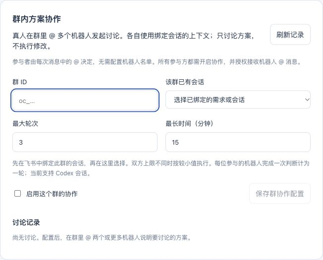

# 群内方案协作 CN 部署

## 版本与环境

- 用户授权 commit / push / merge / 部署；2026-11-15 17:13 CST 完成切换。
- Core PR #10 已合并：`df28a2550de3d85c79f7942b0ad33534fa55daa7`。
- Work PR #15 已合并，部署功能版本：`7691df204f8d7ef45b819c210dba92747e6efb5e`。
- Work 使用 Core 0.45.0 + 已提交 pnpm patch，包含群协作协议、原生启动前排队校验和原 Fast 补丁；未发布新 tag。
- CN `10.37.222.12:3001`，目录 `/data00/home/gouchao/code/github/CodyWork`，systemd 用户服务 `codywork.service`。

## 构建与切换

从远端 main 创建独立暂存 worktree，按锁文件离线安装依赖。类型检查、16 条协作/渠道链路测试、生产构建全部通过，暂存源码无修改。完整自动化和隔离功能验收见[复查报告](2026-11-15-bot-collaboration-review.md)：Core 360 项、Work 479 项通过。

切换前遇到一条真实运行会话，部署脚本在停止服务前退出；等待其完成后再次确认没有 running/awaiting_approval 会话。执行 SQLite online backup，保留原环境配置、前后端产物及依赖，快进 main、离线安装锁定依赖、复制已验证产物并由原 systemd 服务启动。

备份位于 `.runtime/deployments/bot-collaboration-7691df204f8d/`，目录权限 700；包括 `workspace-before.sqlite`、`service-before.env`、`web-previous`、`server-previous`、`deps-root`、`deps-server`、`deps-web`、暂存 source 和构建日志。凭据备份留在服务器，不入库。原生产版本 `c90cf3dc9e312094d8b669fd5542e6d940dc3c16`。快速回退应恢复原代码、依赖和产物；不要用旧数据库覆盖上线后用户数据。

## 部署验证

- HTTP `/api/health` 返回 ok；systemd active/running，PID 1994525，NRestarts=0。
- 前后端 dist 文件集合及 SHA-256 与暂存构建完全一致；Core 版本和 collaboration 导出检查通过。
- SQLite quick_check=ok；原有 Workspace/Repository/Demand/Conversation ID 集合完整保留，数量 4/79/46/115。
- service.env 字节不变，未变更认证、网络、Trae 或机器人配置。
- 三张 collaboration 表创建成功，配置、会话和事件均 0 条，未给真实群开启功能。
- 真实 IAB 使用已有登录状态打开 CN，Workspace 恢复，设置→飞书机器人→群内方案协作显示正常。刷新后表单仍为未启用、3 轮/15 分钟、无记录；未填写或保存真实群配置。
- 桌面页面无水平溢出，浏览器 error/warn 为空。此次线上只读检查覆盖 E2E-001 的已登录启动/恢复部分、E2E-016 桌面部分、E2E-028 配置入口/刷新默认值部分，不等同于完整生产 E2E。
- 机器人经历启动连接中，最终数据库状态 connected，连接时间 17:16:05 CST；最新 server listening 后没有 Unhandled/uncaught/error/timeout 文本。SDK 日志部分仅打印 object，未据此声称完整外部链路正常。

## 观察到的限制

- 首次打开设置出现 Codex `skills/list` 20 秒超时；再次刷新后页面未显示错误。未重启 Codex 或发送模型任务来测试。
- 飞书应用诊断显示缺少 `im:message` 权限；没有自动申请权限或发布应用。
- 诊断中存在历史 update_card 死信，提示超过十四天不能更新。服务启动后的正常渠道恢复也产生了此类失败；未手动点击重试、清空队列或修改历史记录。
- E2E-020 / E2E-028 真实跨应用联调仍 BLOCKED：无获授权专用测试群，本次没有主动发送测试消息。隔离环境 P0 和合成多轮/停止/队列流程已通过，范围以复查报告为准。
- Trae 只读兼容仍属调研，不是已开放功能；手机与 CodyWeb 跨产品验证限制沿用复查报告。

## 清理

线上未创建临时 Workspace、需求、会话或测试任务。浏览器临时页随本轮结束回收；服务器暂存构建及备份保留作回退证据。此报告和截图是后续文档提交，不改变部署功能产物的版本标识。

