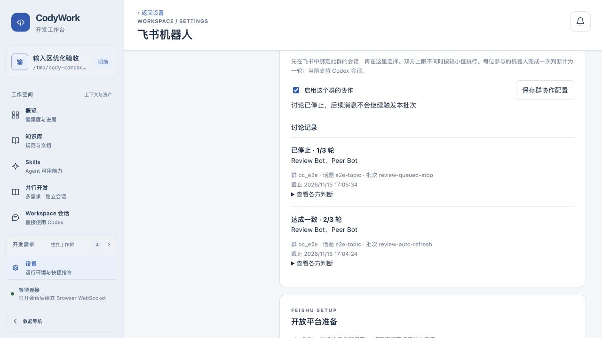

# 群协作整体复查与 Trae 调研

日期：2026-11-15。Work `c90cf3dc9e312094d8b669fd5542e6d940dc3c16` / Core `2cd2e801e6be8869e18eeb130387298153b3ad7d`，均为 `codex/bot-collaboration` 未提交改动。Core v0.45.0 + 本地 pnpm patch，保留原 Fast 补丁。

## 本轮修复

1. 停止/过期后的排队任务：Core 在真正调用 native start 前执行宿主校验，避免只在入队前检查；不会中断前面的人工 Turn。
2. 多个 @ 后的 `/stop`、`/协作停止`、`/协作重开`：先剥离规范化的前置已知提及，再识别指令。
3. Outbox 每次投递和重试前检查群/账号授权、配置、绑定、截止和停止状态。
4. 协作事件按真实参与者身份校验，不仅依赖 sender_type；加入实际群和话题隔离，拒绝机器人伪装真人发起及重复参与者。
5. 自己已发出当前轮判断后收到人工补充，停止旧批次并提示显式重开，避免旧 done 被误当共识。
6. 活跃讨论查询不受后台 200 条展示历史限制；关闭配置和变更绑定停止旧讨论。
7. 附件/原生准备异步执行，避免阻塞停止及其他群；准备失败记入 Inbox，转人工而不是无限重试；交互终态异常显式处理。
8. 开启配置但还没有记录时，后台也每 5 秒拉取，首次讨论自动出现。
9. 当前 Trae ACP 未落实逐轮只读，因此协作暂限 Codex。另已实测 Trae 版本和协议，确认存在 App Server 兼容路线，详见 [调研](../../TRAE_COLLABORATION_COMPATIBILITY.md)。未把命令参数/Schema 验证当成真实只读执行验收。

## 自动化

- Core `pnpm test` PASS：327 Core + 33 Vue = **360**。新增原生排队后失效拦截测试。
- Work `pnpm verify` PASS：279 server + 200 web = **479**，类型检查、服务脚本测试和生产构建通过。
- 目标链路 16 个测试通过：两独立宿主、身份、批次、轮次、限时、停止、队列、失败恢复及完整渠道服务图。
- `git diff --check` 两仓库通过。
- 日志：[Core](2026-11-15-bot-collaboration-review/core-tests.log)、[Work](2026-11-15-bot-collaboration-review/work-verify.log)、[隔离服务器](2026-11-15-bot-collaboration-review/server.log)。最终只调整测试标题和文档，没有改变已验证逻辑。

## 隔离浏览器验收

生产构建，`http://127.0.0.1:43474/`；临时 SQLite 和 Workspace `/tmp/cody-compact-e2e-4mHPUA`，四个临时 Worktree、八个真实产品会话。使用原生协议 fixture（历史持久化）及合成 Feishu provider，未调用真实模型或发送外部消息。IAB 1280×720，三个窗口。

| 用例 | 结果与实际覆盖 |
| --- | --- |
| E2E-001 P0 | PASS：错误密码拒绝，正确临时密码登录；Workspace 和新 Tab 登录状态恢复。 |
| E2E-004 P0 | PASS：侧栏进入 demand_1/conversation_1_1，专属 URL、标题和原生历史刷新恢复。 |
| E2E-007 P0 | PASS：人工消息 C、D 在模型响应前即时出现；镜像 Tab 同步。 |
| E2E-008 P0 | PASS：C、D 正常完成，用户→助手→Worked 顺序；刷新均无重复。失效协作显示失败原因，不伪装执行成功。 |
| E2E-011 P0 | PASS：服务端主动断开 WS 后恢复；第二窗口 Ctrl+Enter 发送 D，第一窗口同步；人工会话继续完成。 |
| E2E-016 桌面 | PASS：实际视口宽度和文档宽度均 1280，无水平溢出；表单焦点、终态正常。两个检查窗口 error/warn 为空。 |
| E2E-028 本地 | PASS：UI 保存开启 3 轮/15 分钟配置，刷新保持；无需手动刷新出现第一次讨论并在 2/3 轮达成一致。第二批次在人工 C 任务后排队，UI 停止后立即显示已停止；人工 C 正常完成，协作显示“批次已结束或当前轮次已失效”；D 继续正常运行。刷新记录仍分别为停止/完成。 |
| E2E-010 队列停止部分 | PASS：原生 fixture 历史停止后只有基线+两轮完成协作+人工 C，共四轮；已停止批次只有 join/stop 投递，没有 decision，没有原生执行。 |
| E2E-019 本地只读部分 | PASS：协作执行由 fixture 拒绝非 readOnly 参数；随后人工 C/D 仍为 Normal/workspaceWrite。真实模型文件/MCP 权限矩阵 BLOCKED，未执行。 |
| E2E-020 / E2E-028 真实跨应用 | BLOCKED：缺获授权专用飞书应用/群，不发送真实消息。真实机器人身份、@ 事件、卡片回读、跨机器投递等仍待联调。 |
| E2E-016 手机 | BLOCKED：上一轮浏览器 viewport override 不生效，本轮实际仍 1280；不宣称手机通过。 |
| CodyWeb 跨产品 | BLOCKED：未有可用隔离实例；Core 自动化不替代产品冒烟。 |

以上 PASS 仅指列出的子流程。没有据此声明完整生产端到端验收完成。

## 验收发现与限制

最初临时 harness 遗漏注入权限检查器，页面自动权限检查用合成 app_id/secret 请求失败（invalid param），没有真实凭证或消息。随后注入合成检查器并重启隔离服务，页面确认完整，最终检查无异常。保存的 server.log 为最终服务日志。这个准备错误不是产品权限错误。

停止前已被远端接受的卡片无法撤回；新增校验阻止的是尚未发送/重试的卡片。排队失效记录沿用通用失败展示；没有把失败记录重建为原生消息。

## 清理与状态

隔离服务 PID 67517 已优雅退出；初始服务 PID 66742 已退出。删除本轮临时 SQLite、Workspace、Worktree、runtime fixture、native history、trigger、临时服务入口和 root 指针。保留报告/无敏感数据的日志/截图。临时浏览器 Tab 由应用结束时回收。远端 Trae 仅探测独立进程、临时目录及协议 Schema，未运行模型 prompt；进程与临时目录关闭/删除。空会话删除命令返回非零，检查近期会话历史未发现本次临时 cwd 的记录；没有删除任何真实用户会话。

没有 commit、push、merge、tag 或部署。
