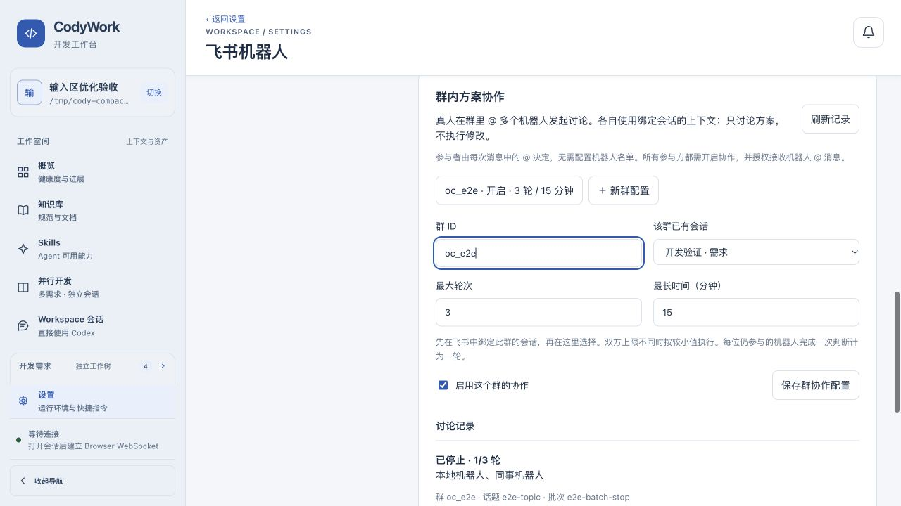
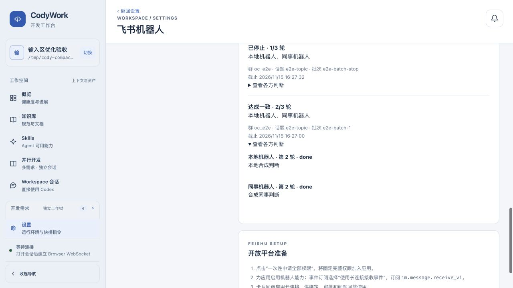

# CodyWork E2E 回归记录：群内机器人方案协作

- 日期：2026-11-15
- 执行者：Codex
- Work revision：`c90cf3dc9e312094d8b669fd5542e6d940dc3c16` + `codex/bot-collaboration` 工作区改动。
- Core revision：`2cd2e801e6be8869e18eeb130387298153b3ad7d` + 同名分支工作区改动。
- Core 依赖：v0.45.0 + pnpm patch（新增协作协议，保留已有 Fast 补丁）。
- URL：`http://127.0.0.1:43473/`，生产构建 + 隔离数据库。
- 浏览器：Codex in-app browser，实际视口 1280×720。
- SQLite：`/tmp/cody-compact-e2e-GWHgjS/db.sqlite`（已删除）。
- Workspace：同目录下 disposable workspace、一个合成 Git 仓库、四个 Worktree、八个真实会话记录。
- Runtime：安全的原生协议 fixture；Thread 历史持久化，非真实模型。Feishu provider 完全合成，不连接外部服务。

## 结论

代码、本地自动化和桌面浏览器协作流程验证通过。尚未完成真实飞书跨应用联调及手机视口验收，不能据此声称生产端到端验收完成。本轮没有 commit、push、merge、tag、部署，也未向真实群发送消息。

## 用例结果

| 用例 | 结果 | 当前版本证据与覆盖范围 |
| --- | --- | --- |
| E2E-001 P0 冒烟 | PASS | 错误密码拒绝；正确测试密码登录；刷新及新 Tab 恢复同一 Workspace，不重复登录；会话页显示已连接。 |
| E2E-004 P0 冒烟 | PASS | 从侧栏进入 demand_1/conversation_1_1，URL、标题及会话一致；刷新和新窗口仍恢复对应原生历史。 |
| E2E-007 P0 冒烟 | PASS | 发送唯一合成消息 1115-A 后，在回复前两个窗口均出现一条用户消息及正在发送状态；随后收敛为正式用户消息。 |
| E2E-008 P0 冒烟 | PASS | A、B 两次正常发送均按用户→助手→Worked 顺序完成；A 刷新后仍仅一条，原生历史包含协作轮次和普通对话。 |
| E2E-011 P0 冒烟 | PASS | 两个 Tab 同步；服务端主动关闭 WebSocket 后恢复已连接；从第二窗口用 Control+Enter 发送 B，得到正常终态回复。 |
| E2E-016 桌面部分 | PASS | 1280px 无水平溢出；表单焦点、按钮、终态及日志正常。发现并修复刷新按钮被压窄折行。 |
| E2E-016 手机部分 | BLOCKED | viewport.set(390×844) 和 reload 后，DOM 与截图仍为 1280×720；工具视口覆盖未生效。已 reset，未将桌面截图当作手机通过。 |
| E2E-028 本地协作流程 | PASS | UI 按 oc_e2e 选已有真实绑定，默认 3 轮/15 分钟，开启并保存；刷新重新选择后值保持。合成双方第 1 轮提出问题，第 2 轮均 done，记录显示达成一致 2/3。结束后新批次从 1/3 开始；模拟对方未加入时手动停止，刷新后保持停止。 |
| E2E-028 真实多应用 | BLOCKED | 未使用获授权的专用飞书群；真实 app-scoped 身份、机器人互相 @ 事件、原始卡片 value 回读、跨机器网络尚未验收。 |
| E2E-019 | BLOCKED（真实渠道） | 本地自动化覆盖未授权用户/群、第三方机器人、迟到事件、只读档位与原会话默认权限隔离；浏览器确认普通会话仍为 Normal。没有把自动化当作完整真实权限 E2E。 |
| E2E-020 | BLOCKED | AGENTS.md 要求真实渠道完整用例；本轮没有专用测试应用/群发送授权。私聊、附件、交互审批、解绑/重试等完整外部矩阵未运行。 |
| CodyWeb 跨产品冒烟 | BLOCKED | 本轮未准备可用的隔离 CodyWeb 测试实例；Core 自动化不能代替对应产品浏览器验收。 |

以上 PASS 限于列出的 P0 冒烟步骤和隔离合成协作流程，不代表扩展用例全部分支或真实模型判断质量通过。

## 自动化

- Core `pnpm test`：326 Core + 33 Vue = **359 tests passed**；包含边界检查和构建。
- Work `pnpm verify`：271 server + 199 web = **470 tests passed**；类型检查和构建通过。最终样式修改后重新执行成功。
- 新覆盖：两套独立数据库/不同应用观察身份、多轮收敛/轮次上限、人工补充/重开、停止/截止、重复乱序、加入先于真人事件、无效模型输出、正常聊天绕过、原生执行链和重启不重复提交。
- 原始证据：[Core](2026-11-15-bot-collaboration/core-tests.log)、[Work](2026-11-15-bot-collaboration/work-verify.log)、[server](2026-11-15-bot-collaboration/server.log)。

## 发现并修复的问题

桌面机器人设置右侧内容栏中“刷新记录”按钮被说明文字挤压折行。对操作按钮设置不收缩与不换行，内容容器允许收缩；最终构建浏览器重新验证正常。

## 界面证据

## 健康检查

- 两个浏览器 Tab console error/warn：均为空（错误密码阶段的预期拒绝另计）。
- 服务端日志：无业务异常；仅 Node experimental SQLite 提示。
- 构建提示：已有大 chunk 建议，无失败。
- 刷新后：配置、达成一致及已停止记录保留；无残留运行状态。
- 协作沿用绑定 Native Thread，后台原生历史可以看到各轮判断 JSON；飞书公开卡片只展示方案/状态，协议放在按钮 value。没有新增镜像消息库。

## 清理

测试服务 PID 12170 已优雅退出；其 runtime/provider/timer 已关闭。已删除隔离目录、SQLite、native fixture 历史、四个测试 Worktree、合成账号以及本轮临时服务入口。视口 override 已 reset；临时浏览器 Tab 未标记保留，由应用在结束时回收。保留本报告、日志和不含真实数据的截图；未清理或修改真实用户仓库/工作空间。
