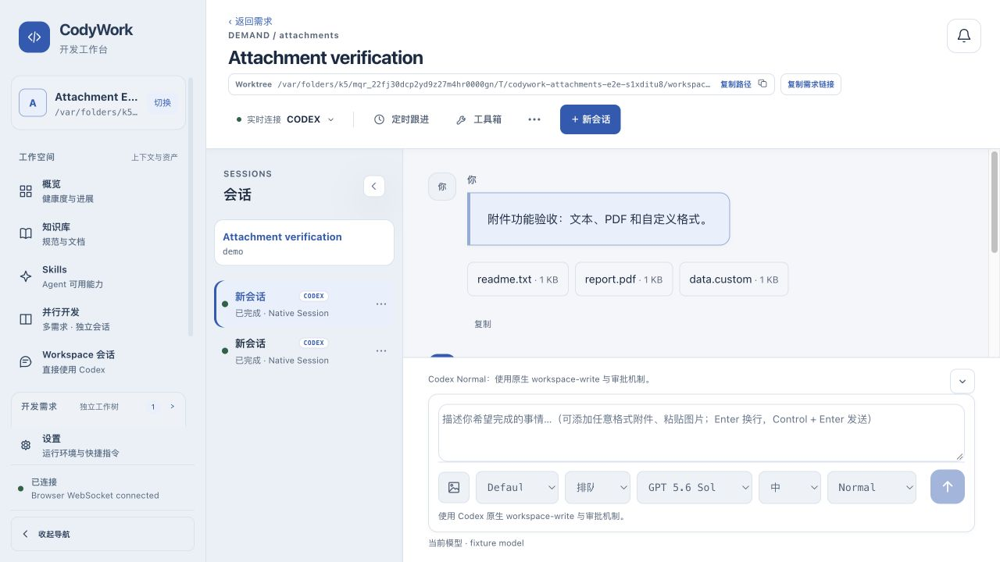
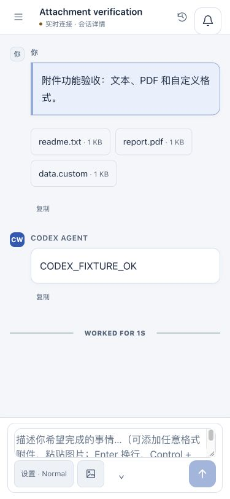

# CodyWork E2E 回归记录：统一会话附件

- 日期：2026-11-15
- 执行者：Codex
- 代码 revision：0610fce2fdc873c22fd3182524421946adf8b1b2 + `codex/unified-attachments` 未提交修改
- Core：Work 固定 0.43.1，保留 Fast 补丁并追加本次共享附件实现；源代码在相邻 CodyWebCore 仓库。BotHub 固定 0.40.0，通过独立包补丁接入。
- 环境：http://127.0.0.1:43471，production build + codex-runtime.mjs 原生协议 fixture
- 浏览器：应用内浏览器，1280×720、375×812；双 Tab
- 数据：一次性 SQLite、Workspace `ws_files`、Demand `demand_files`，隔离 Git baseline/worktree
- Fixture：TXT、PDF 字节样本、自定义二进制扩展名、空文件、21 MiB 超限文件和 PNG。PDF 用于传输验证，不用于验证 PDF 语义解析。

## 结论

共享存储、网页附件发送和历史恢复验证通过。普通需求会话与并行开发面板均可发送附件，附件仅有文件而无正文时也正常。自动检查通过。

本次没有提交、推送、合并或部署。真实飞书收发、真实模型解析和以下未执行用例仍需后续验收；不能将 fixture 结果视为全部生产链路通过。

## 用例结果

| 用例 | 结果 | 证据与范围 |
| --- | --- | --- |
| E2E-001 | PASS | 错误密码拒绝，正确密码登录，恢复隔离 Workspace。 |
| E2E-004 | PASS | Demand 会话深链接在第二 Tab 打开；刷新恢复原生历史和附件下载链接。 |
| E2E-007 | PASS | TXT/PDF/自定义格式多文件发送后立即出现，回复后收敛为原生历史中的文件卡片。 |
| E2E-008 | PASS（正常发送） | 多轮消息顺序正确；刷新后正常发送消息没有重复，附件不暴露清单 JSON 或服务器路径。失败重试情况另列。 |
| E2E-009 | NOT RUN | 未执行完整排队、steer、技能浏览器矩阵。自动测试通过不能代替这部分浏览器验收。 |
| E2E-010 | PARTIAL | 停止运行成功，没有卡住；失败重试保留同一附件 ID。fixture 拒绝执行后的再次重试显示两条失败尝试，见已有问题。 |
| E2E-011 | PASS | 两个 Tab 同步新增消息；测试服务重启后重连、刷新恢复消息与附件。 |
| E2E-012 | PARTIAL | 验证 fixture 拒绝执行和服务重启；未验证真实 Codex 上游断流、审批及提问完整流程。 |
| E2E-013 | PARTIAL | 文件选择、多选、PNG 缩略图与移除、仅附件消息、空文件、超限提示通过。未实际执行粘贴/拖拽和 PNG 原生历史浏览器回归。 |
| E2E-016 | PASS | 1280 与 375 宽度无水平溢出；最后刷新后 console 无 error/warn，服务端无异常。 |
| E2E-019 | 自动测试 PASS；浏览器 PARTIAL | API 测试覆盖跨会话拒绝、非图片强制下载、旧图片路由下载 HTML 的安全边界；浏览器实际下载 TXT 成功。未进行完整权限矩阵。 |
| E2E-020 | BLOCKED | 没有真实飞书测试发送授权，本次未发送外部消息。模拟 Channel 测试通过，不替代真实附件下载与回复。 |
| E2E-027 | PARTIAL | 并行页添加已有需求、选择真实会话、上传自定义文件并发送、刷新恢复通过；未重新执行多面板并发全矩阵。 |

另：CodyWebUI 独立消费者页面未运行回归；Core Vue 原有图片模式的自动测试通过。

## 发现并修复的问题

1. 仅附件消息在原生 runtime 去掉开头空白后，清单无法识别，页面出现原始 JSON。解析器现在同时支持消息开头和正文后的标记；新增自动回归，并用空文件、仅 PDF 消息、刷新及服务重启复验。
2. 旧图片附件的固定尺寸导致通用文件名裁切。改为适配文件名的 chip；桌面和窄屏检查通过。
3. 非图片可能通过旧 `/images` 路由读取。两类下载路由均对非图片强制下载并设置 nosniff，自动测试覆盖 HTML 文件。

## 未解决问题与阻塞

- 失败尝试重试后显示两条失败记录：在 `2026-11-14-theme-system.md` 已记录主分支基线复现。本次确认附件引用未丢失，但没有修复该既有重试展示问题。
- 本实现不提供自动 PDF/OCR/Office 解析。文件已传给 Runtime；能否读取内容取决于执行环境可用工具。
- 真实飞书、真实模型理解、独立 CodyWebUI 页面以及上表 NOT RUN/PARTIAL 部分未被此报告认证。

## 健康检查

- Core `pnpm build`、`pnpm test`：314 Core + 32 Vue，共 346 通过。
- Work `pnpm verify`：264 server + 198 web，共 462 通过；类型检查和构建通过。
- Hub `pnpm check`：180 server + 14 web，共 194 通过；14 个已有 server 测试跳过；类型检查和构建通过。
- 构建仅存在 chunk 大小提醒、Node SQLite 实验性提醒。
- 浏览器最终 console：无 error/warn；重启期间预期出现断连状态。
- 服务端异常日志：未发现。
- 刷新后最终状态：已完成，文件名和下载入口保留，不出现内部清单正文。

## 截图

## 清理

已停止 43471 端口的一次性服务进程，删除 `codywork-attachments-e2e-s1xditu8` 中的隔离 Workspace、Worktree、SQLite、上传文件与 fixture 状态；下载目录中内容精确匹配测试标记的 readme.txt 已删除。截图留存在本报告 assets 目录。没有清理或重置真实用户仓库。

## 正式发布依赖复验

用户随后授权提交、合并与部署。Core 已发布 v0.44.0；Work 升级到该标签，附件临时补丁已移除，仅保留原有 Fast 模式补丁。重新执行 `pnpm verify`：264 server + 198 web 全部通过，类型检查与生产构建通过。Core 0.43.2 已支持进程退出后的下一次显式操作恢复；本次同步更新 Work 的旧断线测试，验证恢复不会重放失败轮次，且下一轮可以继续。

BotHub 在最新 main 上独立接入 v0.44.0，`pnpm check`：188 server + 14 web 通过，14 项既有跳过。真实飞书与真实模型解析的验收限制不变。
