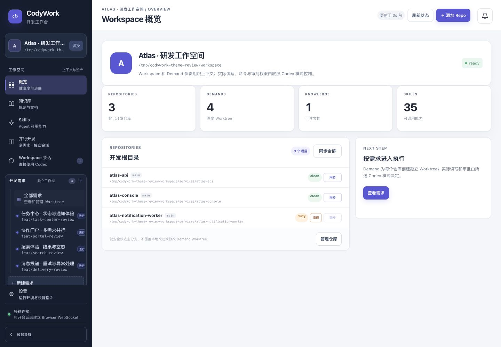
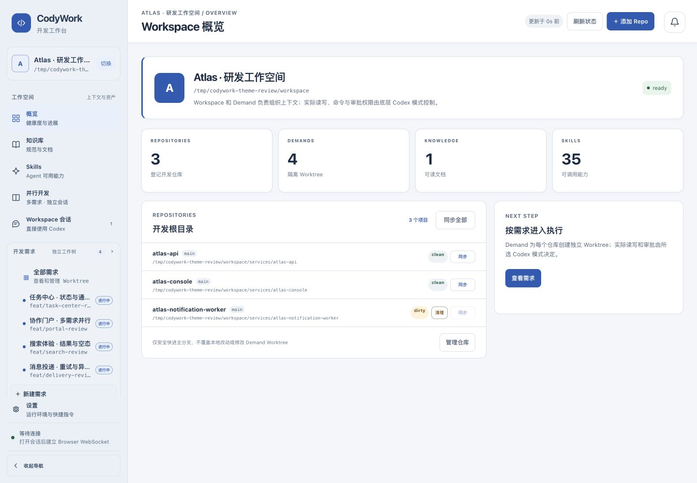

# CodyWork 主题改造与验收说明

当前交付分支为 `codex/workbench-theme-system`，基于 main `d1cb439`。本目录记录发布前完成的本地 UI 交付审计；GitHub 合并与服务器部署状态以对应 PR 和发布记录为准。全量业务 E2E 仍有明确未验证项，见 [最终审计](FINAL_AUDIT.md)。完整状态见 [PROGRESS.md](PROGRESS.md) 和 [E2E 记录](../e2e/runs/2026-11-14-theme-system.md)。

## 三个方向

- **清爽专业（默认）**：冷白内容面板、墨蓝文字、浅灰蓝导航，适合长时间处理需求和代码；主操作使用深蓝，工具操作降低视觉权重。
- **深色科技**：深蓝画布、分层蓝灰面板、青色强调；不使用大面积发光和玻璃效果，保证工具输出、表格与输入区清楚。
- **松林手记**：暖纸背景、松绿色强调、较小圆角和轻阴影，给研发工作台更温和的辨识度。三主题的信息架构和行为一致。

在「设置 → 工作台外观」切换，选择保存在当前浏览器；跨标签同步，刷新时在应用挂载前应用主题。未设置或无效值回到默认主题。存储不可用时仍可切换本次页面的主题。

## 实现边界

主题变量集中在 `apps/workbench-web/src/theme-tokens.css`，公共组件使用语义颜色、表面、状态、圆角、阴影和动效。登录页使用构建输出的同一份主题变量。Core 会话展示通过产品样式变量桥接；原生历史、协议、权限、命令网关和业务API未另建实现。

使用系统中文字体；不增加字体网络依赖。主题预览卡保留固定预览色，Mermaid使用白色画布以保证图形可读性，图片灯箱保持深色衬底。

新增交互基础：产品自定义弹窗焦点范围、键盘Tab循环、Esc业务守卫、嵌套与原入口恢复；原生dialog保留浏览器焦点机制。抽屉转弹窗先关闭原生顶层，再捕获可见入口。

## 本地运行

在项目根目录执行：

```sh
pnpm install --frozen-lockfile
pnpm verify
pnpm dev
```

生产构建预览可指定隔离数据库，避免影响现有工作区：

```sh
pnpm build
mkdir -p /tmp/codywork-ui-preview
CODYWORK_DB=/tmp/codywork-ui-preview/workspace.db \
  node apps/workbench-server/dist/index.js --host 127.0.0.1 --port 43351
```

端口已占用时另选空闲端口。测试模型依赖本机配置的Runtime；验收分别使用 `/tmp` 下原生协议夹具和独立的真实 Codex 实例（43356），后者仅执行合成任务。未发送外部消息；夹具结果不等于实际模型或飞书送达。

## 验证证据

自动检查包含主题存储/跨标签行为、三主题正文对比度、弹窗焦点，以及原项目业务测试。浏览器验收覆盖真实UI导航、合成Workspace/Repo/Demand、原生协议会话与站内通知。具体完整通过、部分已观察、未执行和外部阻塞按E2E记录分别列出。

代表截图位于 [assets](assets)。严格前后对比使用 `overview-main-same-data.jpg` 与 `overview-professional-same-data.jpg`：同为1440×1000、同一隔离工作区（3仓库、4需求、1文档、35 Skills），旧版为 main d1cb439 的独立构建，新版为当前分支。两张均已打开查看。`overview-midnight-final.jpg` 展示同数据深色版本。早期 overview-before/overview-professional-after 数据量不同，仅作历史记录。主要页面/主题/尺寸已有代表性证据；本地验证结束，隔离服务与测试目录已清理。真实外发、Skill安装沙箱和工具限制等按最终审计列明，不能宣称全量业务E2E全部通过。

## 前后对比与主题预览

相同数据与1440×1000视口：

| main 改造前 | 清爽专业（默认） |
| --- | --- |
|  |  |

[深色科技](assets/overview-midnight-final.jpg) · [松林手记](assets/settings-forest-migrated.jpg) · [375短屏会话](assets/workspace-empty-forest-short-mobile.jpg) · [通知待处理](assets/notification-attention-midnight.jpg)

完整工程检查：服务端263、前端179项测试及类型检查/构建通过，见 [原始日志](evidence/verify-final.log)。P0与额外用例的完整结果见E2E报告；限制、基线缺陷及清理明细见最终审计。
